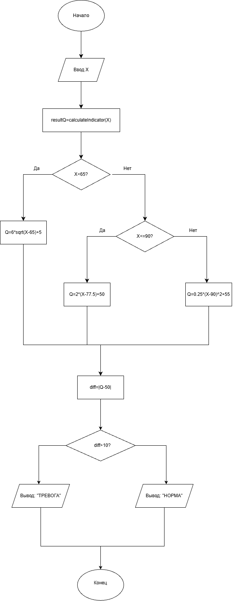

# Курсовой проект

### Система мониторинга активности катализатора реактора

## Постановка задачи

Разработать программу на языке Си для мониторинга технологического процесса (активности катализатора в реакторе). Программа должна:
1) Вычислять показатель Q на основе введенного значения активности X по заданной кусочно-линейной формуле.
2) Осуществлять оперативный контроль: сравнивать полученное значение Q с номинальным (Q0 = 50.00) и сигнализировать о состоянии процесса (Норма или Тревога) при отклонении более чем на 10 единиц.

### Блок-схема

