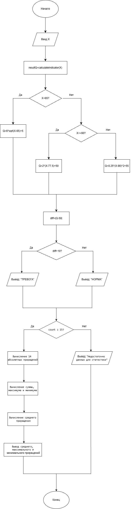

# Курсовой проект

## Система мониторинга активности катализатора реактора

## Описание проекта

Программа предназначена для расчёта показателя активности катализатора реактора и определения его состояния. По введённому значению X вычисляется показатель Q, после чего определяется отклонение от номинального значения. Если отклонение превышает допустимый порог, система выдаёт предупреждение «ТРЕВОГА».

Программа позволяет вводить измерения вручную, а также считывать их из файла и последовательно обрабатывать. Дополнительно реализована возможность изменения допустимого отклонения и проведения статистического анализа первых 15 измерений.

## Входные данные

1. Входной параметр X — активность катализатора, выраженная в процентах.
2. Допустимый диапазон значений: от 0 до 100 включительно.
3. Если введённое значение выходит за пределы диапазона, программа выводит сообщение об ошибке.
4. Номинальное значение показателя: Q0 = 50.
5. Допустимое отклонение: ΔQ = 10.
6. Количество измерений при обработке файла — не более 40.

## Математическая модель

Для расчёта показателя активности катализатора используется кусочно-заданная функция:

\[
Q(X)=
\begin{cases}
6\sqrt{X-65+1}+5, & X<65,\\
2(X-77.5)+50, & 65\leq X\leq90,\\
0.25(X-90)^2+55, & X>90.
\end{cases}
\]

Границы 65 и 90 разделяют диапазон на три участка, для каждого из которых применяется своя формула.

Допустимый диапазон входного параметра: 0 ≤ X ≤ 100.

Для определения состояния катализатора рассчитывается абсолютное отклонение от номинального значения:

\[
\Delta Q=|Q-Q_0|
\]

Если отклонение не превышает допустимый порог (ΔQ ≤ 10), состояние определяется как «НОРМА».

Если отклонение превышает допустимый порог (ΔQ > 10), программа выводит сообщение «ТРЕВОГА».

## Ручной расчёт

### Пример 1. X = 80

Так как 65 ≤ 80 ≤ 90, используется вторая формула:

Q = 2 · (80 − 77.5) + 50 = 55.

Рассчитываем отклонение:

ΔQ = |55 − 50| = 5.

Так как 5 ≤ 10, состояние катализатора — «НОРМА».

### Пример 2. X = 100

Так как X > 90, используется третья формула:

Q = 0.25 · (100 − 90)² + 55 = 80.

Рассчитываем отклонение:

ΔQ = |80 − 50| = 30.

Так как 30 > 10, состояние катализатора — «ТРЕВОГА».

## Режимы работы программы

После запуска программы отображается главное меню:

1. Ручной ввод.
2. Чтение измерений из файла.
3. Изменение допустимого отклонения.
0. Выход.

### Ручной ввод

Пользователь вводит значение X с клавиатуры. Программа проверяет корректность введённого значения, рассчитывает показатель Q, определяет отклонение и выводит состояние катализатора.

### Чтение измерений из файла

Программа считывает данные из файла input.txt и последовательно обрабатывает каждое измерение. Для каждого значения выполняется проверка, расчёт показателя Q и определение состояния катализатора.

### Изменение допустимого отклонения

Пользователь может самостоятельно задать новое положительное значение допустимого отклонения. После изменения это значение используется при последующих расчётах как в ручном режиме, так и при обработке файла.

## Формат входного файла

Для обработки измерений используется текстовый файл input.txt.

Каждое значение X записывается с новой строки. Допускается наличие пустых строк. Значения должны находиться в диапазоне от 0 до 100.

Пример содержимого файла:

    80
    100
    70
    85
    90

Программа последовательно считывает значения до достижения конца файла. Максимальное количество обрабатываемых измерений — 40.

## Последовательность обработки данных

При выборе режима чтения из файла программа выполняет следующие действия:

1. Открывает файл input.txt.
2. Проверяет успешность открытия файла.
3. Последовательно считывает входные значения.
4. Проверяет корректность каждой записи и допустимость значения X.
5. Рассчитывает показатель активности Q.
6. Определяет отклонение от номинального значения.
7. Выводит результат и состояние катализатора.
8. Переходит к следующему измерению.
9. После достижения конца файла выводит количество обработанных измерений.
10. При наличии не менее 15 измерений выполняет статистический анализ первых 15 результатов.

## Статистический анализ

После обработки файла программа выполняет статистический анализ первых 15 рассчитанных значений Q, если количество измерений составляет не менее 15.

В ходе анализа вычисляются:

- Средний абсолютный прирост — среднее значение модулей разностей между соседними показателями Q.
- Максимальный прирост — наибольшее значение модуля разности между соседними показателями.
- Минимальный прирост — наименьшее значение модуля разности между соседними показателями.

Для расчёта используется 14 разностей между 15 последовательными значениями Q.

## Обработка ошибок

В программе предусмотрена обработка следующих ситуаций:

- Не удалось открыть файл input.txt.
- Файл не содержит измерений.
- В файле обнаружена некорректная запись.
- Введённое значение X выходит за допустимый диапазон.
- Обнаружена слишком длинная строка.
- Количество измерений превышает 40.
- Возникла ошибка при чтении файла.
- Количество измерений меньше 15 — в этом случае статистический анализ не выполняется.

При возникновении ошибки программа выводит соответствующее сообщение.

## Блок-схема

## Информация о разработчике

Дегтярева Полина, бИЦТ-262
