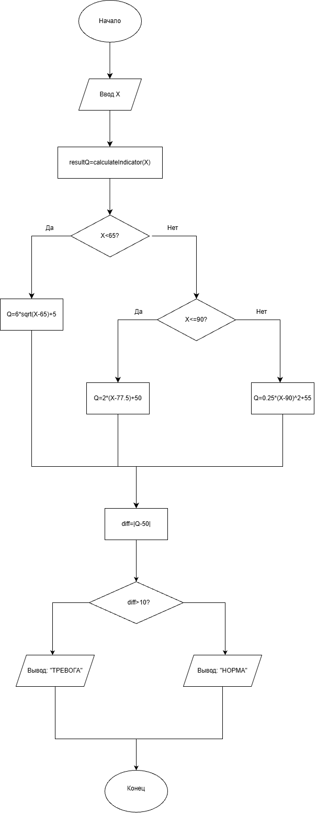

# Курсовой проект

### Система мониторинга активности катализатора реактора

## Описание проекта
Программа предназначена для расчёта показателя активности катализатора реактора и определения его состояния. По введённому значению (X) вычисляется показатель (Q), после чего определяется отклонение от номинального значения. Если отклонение превышает допустимый порог, система выдаёт предупреждение «ТРЕВОГА».

## Входные данные
1) Входной параметр (X) — активность катализатора, выраженная в процентах.
2) Допустимый диапазон: 0 <= X <= 100.
3) Если введённое значение выходит за пределы диапазона, программа выводит сообщение об ошибке и завершает работу.
4) Номинальное значение показателя: Q0=50.
5) Допустимое отклонение: ΔQ=10.

## Математическая модель
Показатель (Q) рассчитывается по кусочно-заданной функции:

$$
Q(X) =
\begin{cases}
6 \cdot \sqrt{X - 65 + 1} + 5, & X < 65, \\[6pt]
2 \cdot (X - 77.5) + 50, & 65 \leq X \leq 90, \\[6pt]
0.25 \cdot (X - 90)^2 + 55, & X > 90.
\end{cases}
$$

Границы 65 и 90 разделяют три режима расчёта показателя. Для каждого режима используется своя формула.
Область допустимых входных значений программы:

$$
0 \leq X \leq 100
$$

Состояние системы определяется по формуле:

$$
\Delta Q = |Q - Q_0|
$$

Если отклонение не превышает 10, состояние считается нормальным. Если отклонение больше 10, программа выдаёт предупреждение «ТРЕВОГА».

## Ручной расчёт
### Пример 1. X = 80.
Так как X находится в диапазоне от 65 до 90, используем вторую формулу:

$$
Q = 2 \cdot (80 - 77.5) + 50
$$

$$
Q = 2 \cdot 2.5 + 50
$$

$$
Q = 5 + 50 = 55
$$
Вычислим отклонение от номинального значения:

$$
\Delta Q = |55 - 50| = 5
$$

Отклонение равно 5 и не превышает допустимое значение 10. Следовательно, состояние системы — НОРМА.

### Пример 2. X = 100.
Так как X больше 90, используем третью формулу:

$$
Q = 0.25 \cdot (100 - 90)^2 + 55
$$

$$
Q = 0.25 \cdot 10^2 + 55
$$

$$
Q = 0.25 \cdot 100 + 55
$$

$$
Q = 25 + 55 = 80
$$

Вычислим отклонение от номинального значения:

$$
\Delta Q = |80 - 50| = 30
$$

Отклонение равно 30 и превышает допустимое значение 10. Следовательно, состояние системы — ТРЕВОГА.

## Блок-схема

## Информация о разработчике

Дегтярева Полина, бИЦТ-262
